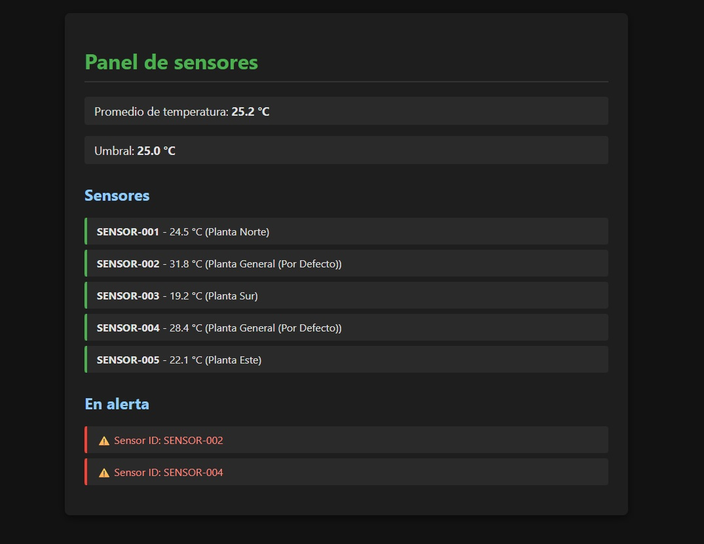
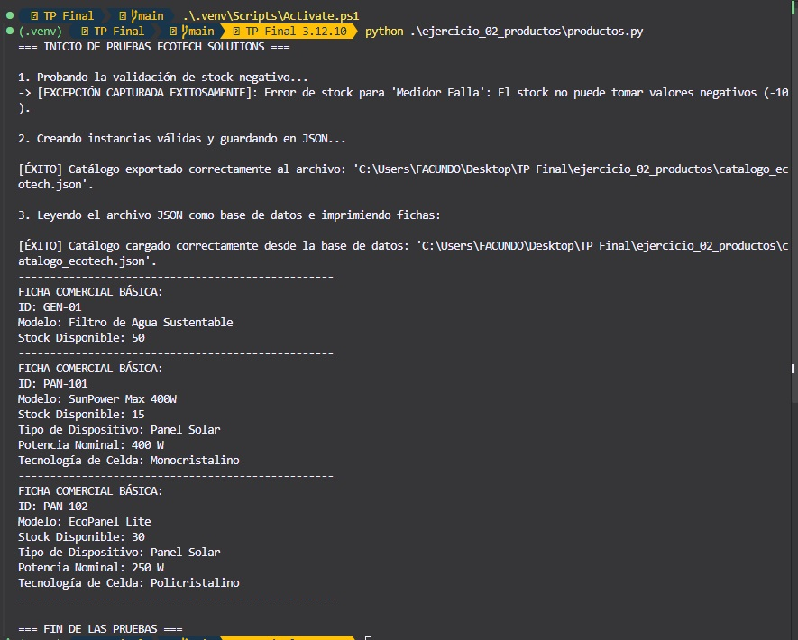

# TP Final - Programación Python | Fundación Santisima Trinidad

## 👨‍🎓 Alumno

**Facundo Martín Steckler**  
**DNI:** 32.627.327

---

## 📖 Descripción del Proyecto

Este Trabajo Práctico Final desarrolla una solución integral para la empresa ficticia **EcoTech Solutions**, dedicada a la gestión de tecnología sustentable y monitoreo ambiental.

La aplicación implementa conceptos fundamentales de programación en Python, incluyendo:

- Programación estructurada.
- Programación orientada a objetos.
- Manejo de excepciones.
- Serialización y persistencia de datos en formato JSON.
- Testing automatizado con `unittest`.
- Procesamiento de datos.
- Integración con el framework Django.

El proyecto está dividido en tres ejercicios que simulan distintos requerimientos de un entorno empresarial relacionado con la sustentabilidad, el monitoreo industrial y la administración de recursos tecnológicos.

---

# 📋 Consigna General

La solución debe abordar tres escenarios principales:

1. Procesamiento y análisis de datos provenientes de sensores ambientales.
2. Gestión de inventario de dispositivos ecológicos mediante Programación Orientada a Objetos.
3. Auditoría de algoritmos mediante pruebas unitarias e integración con una aplicación web basada en Django.

---

# 🧹 Ejercicio 1 - Sanitización y Análisis Estadístico de Sensores

## Objetivo

Procesar información proveniente de sensores térmicos que transmiten datos en formatos heterogéneos, permitiendo su normalización y posterior análisis estadístico.

### Funcionalidades Implementadas

#### Punto A - Normalización de Lecturas

Función:

```python
limpiar_registro_sensor(registro_raw)
```

Responsabilidades:

- Eliminar espacios innecesarios del identificador del sensor.
- Convertir temperaturas expresadas como texto a valores numéricos (`float`).
- Remover unidades de medida incluidas en la lectura.
- Asignar una ubicación predeterminada cuando el dato no se encuentre disponible.

#### Punto B - Monitoreo y Mapeo Estadístico

Función:

```python
generar_resumen_sensores(lista_sensores_limpios, umbral_temperatura)
```

Responsabilidades:

- Identificar sensores que superen un umbral establecido.
- Calcular el promedio general de temperatura.
- Generar un reporte consolidado de monitoreo.

### 🌐 Acceso mediante Navegador

Ruta de acceso:

```text
IP + /sensor/panel/
```

Ejemplo:

```text
http://127.0.0.1:8000/sensor/panel/
```


---

# 🌱 Ejercicio 2 - Modelo de Productos, Excepciones y Persistencia

## Objetivo

Diseñar un sistema de inventario para dispositivos sustentables utilizando Programación Orientada a Objetos.

### Componentes Principales

#### Excepción Personalizada

```python
StockInvalidoError
```

Utilizada para evitar que un producto pueda poseer cantidades negativas en stock.

#### Clase Base

```python
DispositivoEcologico
```

Características:

- Encapsulamiento de atributos.
- Validaciones de negocio.
- Gestión segura del stock.

#### Clase Derivada

```python
PanelSolar
```

Características:

- Herencia desde la clase base.
- Atributos específicos de paneles solares.
- Polimorfismo mediante la personalización de la ficha técnica comercial.

### Persistencia de Datos

Clase:

```python
GestorInventario
```

Método principal:

```python
guardar_catalogo_json()
```

Funcionalidades:

- Conversión de objetos a estructuras serializables.
- Exportación de datos a JSON.
- Generación automática del archivo:

```text
catalogo_ecotech.json
```


```Comando de terminal: 
python .\ejercicio_02_productos\productos.py
```




---
